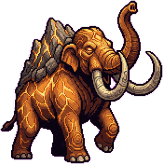
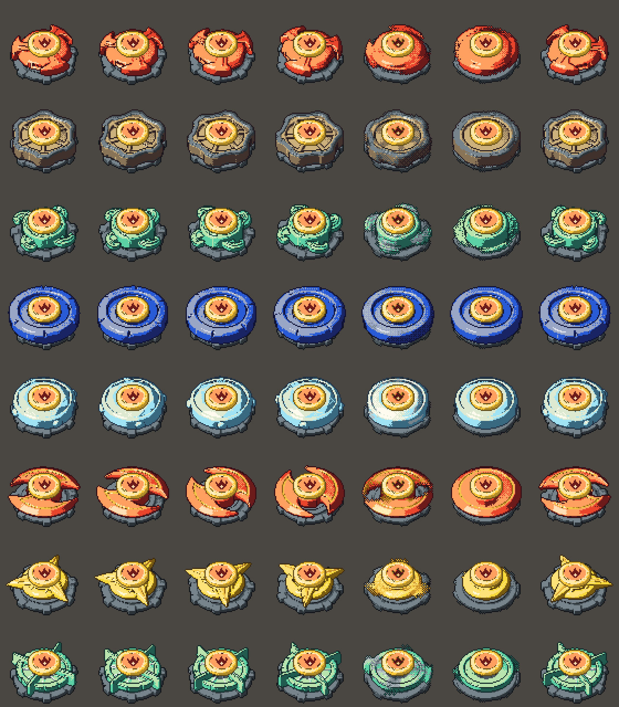

# Devran

**Devran: özgün dönen topaç dövüşü; kâr amaçsız.** Tarayıcıda, gerçek zamanlı 1v1: üç topaçlık takımınla çanakta
rakibi durdur, dışarı at ya da parçala. Klavye sürer, fare nişan alır; her topacın Çekirdeğinde bir ruh, ruhun
yetenekleri, Ulti'si ve takımın paylaştığı **Takım Ultisi** var. Kick yayınlarında izleyicilerin kendi hesabıyla
oynaması ve yayıncının OBS'te **seyirci görünümünü** göstermesi için yapıldı. Reklam yok, satın alma yok.

**Durum (6 Kasım 2026):** D1–D8 dilimleri bitti (sim, yetenekler + Ulti + Takım Ultisi, çevrimiçi maç, hesaplar,
Atölye, Market, Başarımlar, Altın, hızlı maç, sonuç ekranı, seyirci/OBS görünümü, gizlilik + hesap silme, krediler).
Üstüne: üç boyutlu Atölye, çarpışma fiziği ve kıvılcım cilası, Gemini + Tripo + Blender parça hattı, altı element için kutsal
canavar (Ata) ve rehber karakter Pergel. Kod kapıları yeşil (`npm test` 488/488, lint, typecheck, build). İnsanla oyun testi
henüz yapılmadı. Sırada: ilk test gecesi ([docs/production/test-gecesi.md](docs/production/test-gecesi.md)), menü düzeltmeleri,
ağ gecikmesi hedefi ve Kick girişi. Güncel tablo ve çıkış planı:
[docs/production/durum-20261105.md](docs/production/durum-20261105.md); dilim raporları `docs/production/raporlar/`.

## Hızlı başlangıç

```bash
npm install
npm run dev          # http://localhost:5173 (istemci + Colyseus sunucusu tek süreçte)
```

| Ekran | Adres | Ne |
|---|---|---|
| Karşılama / Atölye | `/` | kayıt, giriş, takım kurma |
| Lobi | `/?ekran=lobi` | hızlı maç, oda kodu (`#oda=ABCDEFGH`) |
| Seyirci (OBS) | `/#izle=ABCDEFGH` (`&seffaf=1`) | giriş yok, kontrol yok; Lobi'de "Seyirci bağlantısını kopyala" |
| Bota karşı maç | `/?ekran=mac&oto=dolas` | çevrimdışı tam maç (`oto`: bot oynar) |
| Topaç Lab | `/?ekran=topac-lab` | tek tur, parça denemesi |
| Gizlilik · Krediler | `/gizlilik` · `/krediler` | |

## Komutlar

| Komut | Ne |
|---|---|
| `npm test` · `npm run lint` · `npm run typecheck` · `npm run build` | kapılar |
| `npm run test:tarayici` | altın senaryo hash'leri Node = Chromium (deterministik sim) |
| `npm run altin:uret` | altın senaryoları yeniden üret (bilinçli sim değişikliğinde) |
| `npm run denge:turnuva` | bot turnuvası (süre, bitiş dağılımı, kazanım bandı) |
| `npm run ag:matris` · `npm run ag:ekran` | ağ profili (N2/N3) iki istemci hash denetimi |
| `npm run krediler:uret` | krediler ↔ varlık manifestleri denetimi |
| `npm run dev:ag` | geliştirme sunucusu yerel ağa açık (telefonla deneme, aşağıda) |
| `npm run mobil:denetim` · `npm run mobil:mac` | telefon emülasyonu: menü denetimi ve dokunmatik maç (Playwright, `KLASOR=… CIHAZ=iphone14\|iphone15max\|pixel7\|kucuk`) |

## Telefonla deneme

Oyun telefonda **yatay** oynanır (iOS Safari, Android Chrome). Dokunmatik cihazda sol başparmak sanal joystick'le sürer,
sağ altta Dash · Sekme · Yetenek 1-2 · Ulti · Takım Ultisi düğmeleri var; nişan kendiliğinden en yakın rakibe döner,
sağ tarafta sürükleyerek ya da yetenek düğmesinden sürükleyerek ezilir (ayrıntı: `docs/production/raporlar/MOBIL-1.md`).

**Aynı Wi-Fi'den (en kolayı):**

1. Bilgisayar ve telefon aynı Wi-Fi'de olsun (misafir ağları cihazları birbirinden yalıtabilir).
2. `npm run dev:ag` çalıştır. Vite çıktısında `Network: http://192.168.x.y:5173/` satırı görünür. Görünmezse bilgisayarın
   yerel IP'sini bul: Windows `ipconfig` (IPv4 Address), macOS `ipconfig getifaddr en0`, Linux `hostname -I`.
3. Telefonda `http://<bilgisayarın-IP'si>:5173` aç, cihazı yatay çevir. Port `5173` (Colyseus aynı süreçte, ayrı port yok).
4. Bağlanmıyorsa bilgisayarın güvenlik duvarı 5173'e gelen bağlantıya izin vermeli (Windows ilk açılışta sorar).

Geliştirme modunda sunucu yerel ağ kökenlerini (10.x, 172.16-31.x, 192.168.x, `*.local`) Origin denetiminden geçirir ve
oturum çerezi `Secure` olmadan (HTTP) çalışır. **Üretimde değişiklik yok:** `NODE_ENV=production` iken yalnız
`IZINLI_KOKENLER` listesindeki kökenler kabul edilir, çerez `Secure`'dur.

**Dışarıdan / farklı ağdan (açık adres):** Cloudflare Tunnel hızlı tüneliyle:

```bash
cloudflared tunnel --url http://localhost:5173          # https://<rastgele>.trycloudflare.com verir
DEV_EK_HOSTLAR=<rastgele>.trycloudflare.com IZINLI_KOKENLER=https://<rastgele>.trycloudflare.com,http://localhost:5173 npm run dev:ag
```

`DEV_EK_HOSTLAR` Vite'ın ad denetimine tünel adını ekler; `IZINLI_KOKENLER` verilince Origin denetimi yalnız listeye
bakar (yerel ağ ayrıcalığı kalkar). Tünel HTTPS olduğu için Tam ekran, Ekran uyku kilidi ve "Ana Ekrana Ekle" (PWA)
yalnız bu yolla tam denenir; yerel ağdaki `http://` adresinde tarayıcılar bunların bir kısmını kapatır.

## Görsel varlıklar nasıl üretiliyor

Sanatın tamamı küçük bir ekip için yapay zekâ destekli bir hatla üretiliyor: **fikir → 3B model → piksel sanat → oyun**.

1. **Gemini** tek karelik konsept ve portreyi çizer.
2. **Tripo** o görselden 3B model çıkarır.
3. **Blender** modeli oyunun kamerasından, her yönden ve hız kademesinde çizer.
4. Betikler sonucu ortak bir palet ve ince konturla **piksel sanata** çevirir; çıktı oyuna sayfa olarak girer.

Hat yalnız geliştiricinin makinesinde çalışır, anahtarlar depoya girmez. Ayrıntı: [araclar/sanat/README.md](araclar/sanat/README.md), kaynaklar ve kullanım notları: [docs/art/krediler.md](docs/art/krediler.md).

| | |
|---|---|
|  |  |
| **Dağ Mamutu**, Kaya elementinin kutsal canavarı (Ulti'de belirir) | **Topaç gövdeleri**, aynı model farklı açılardan ve dönüş hızlarında |

## Mimari (kısa)

- **Paylaşılan sim** (`src/paylasilan/`): 60 Hz sabit adım, deterministik (tarayıcı = Node, FNV-1a 64 hash). Bot da burada.
- **Sunucu** (`src/sunucu/`): Colyseus 0.18 yetkili oda, SQLite (better-sqlite3), REST uçları. Ayrıntı: [docs/tech/backend.md](docs/tech/backend.md).
- **Ağ** (`src/ag/`): protokol, durum şeması; istemci kendi topacını tahmin eder, rakibi 100 ms geriden ara değerler. [docs/tech/netcode.md](docs/tech/netcode.md).
- **İstemci** (`src/istemci/`): Vite + TypeScript + PixiJS 8; HUD DOM katmanı.

## Belge haritası

| Konu | Nerede |
|---|---|
| Durum ve çıkış planı | [docs/production/durum-20261105.md](docs/production/durum-20261105.md), [kalan-is.md](docs/production/kalan-is.md), [roadmap.md](docs/production/roadmap.md) |
| Oyun tasarımı ve dünya | `docs/design/beyblade/` (lore, arena, sahip kararları, oyuncu yolculuğu, sözlük, çarpışma hissi, kutsal canavarlar), sayılar: [docs/design/tuning.md](docs/design/tuning.md) |
| Teknik | [mimari](docs/tech/mimari.md), [netcode](docs/tech/netcode.md), [backend](docs/tech/backend.md), [veri modeli](docs/tech/veri-modeli.md), `docs/tech/adr/` |
| Sanat | [docs/art/topac-pixel-plani.md](docs/art/topac-pixel-plani.md), [krediler](docs/art/krediler.md), araç hattı `araclar/sanat/` |
| Kontrol ve arayüz | [docs/ux/kontrol-ve-hud.md](docs/ux/kontrol-ve-hud.md), [Pergel](docs/ux/bilgic-pergel.md) |
| Dağıtım | [deploy/README.md](deploy/README.md) |

## Geliştirme kuralları

- **Paylaşılan sim kutsaldır:** `src/paylasilan` içinde DOM, Node API, `Date.now`, tohumsuz `Math.random` yok; istemci ve sunucu aynı adımı bit bit çalıştırır (ESLint kapısı).
- **Sunucu yetkilidir:** konum, Stamina, vuruş ve sonuç sunucuda belirlenir; istemci yalnız girdi yollar.
- **Sayılarda** [docs/design/tuning.md](docs/design/tuning.md) kazanır; oyuncuya görünen terimler genel oyun terimleridir.
- **Kod kimlikleri** Türkçe ASCII, kitaplık API'leri ve commit iletileri İngilizce (`feat:`, `fix:`, `docs:`, `art:`…).
- **Ağ iddiası** için gecikme, titreşim ve kayıp değerleri yazılı iki gerçek istemci testi gerekir; yerel test çok oyunculu kanıt sayılmaz.
- **Ücretli çağrılar, alan adı ve bulut kaynağı** için önce sahip onayı; anahtarlar yalnız ortamdan, depoya girmez.

## Lisans ve krediler

Kod: lisans dosyası henüz yok (depo sahibi seçecek); katkılar PR ile. Üçüncü taraf
varlıklar ve yazılımlar: oyun içi `/krediler` sayfası ve [docs/art/krediler.md](docs/art/krediler.md). Devran'ın
dünyası, topaçları ve ruhları özgündür; herhangi bir marka ya da başka bir oyunla bağı yoktur.
