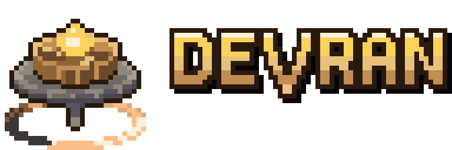
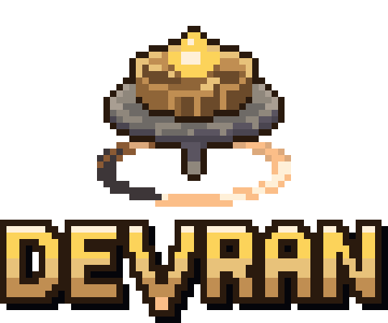
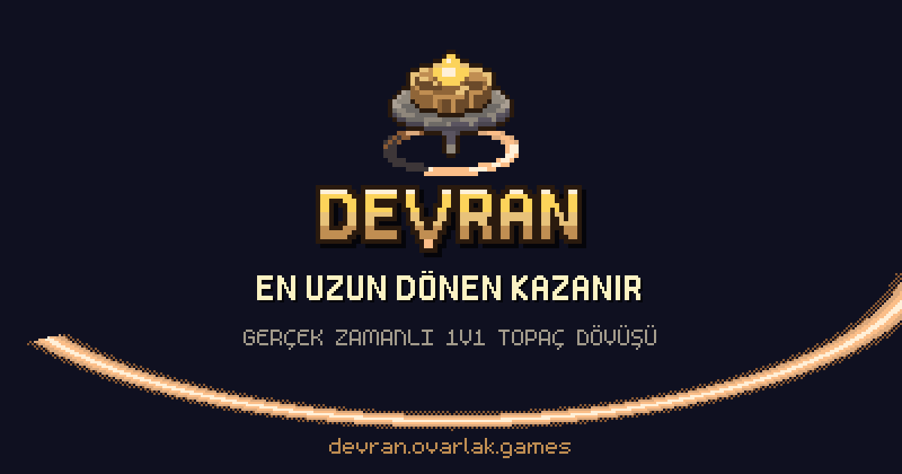
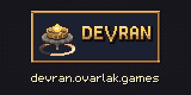

# Devran kurumsal kimlik (logo, renk, yazı, kullanım)

**Tarih:** 2026-11-06 · **Şapka:** `@iris` (sanat yönetimi) · **Dal:** `devran-kod` · **Durum:** ilk sürüm, sahibin isteğiyle ("devran için logo ve kurumsal kimlik çalışması yap") yazıldı ve canlıya alındı. Sahip itiraz ederse geri alınır.

**Otorite.** Marka görünüşünde bu belge kazanır. Oyun içi arayüz kuralları (`docs/art/tasarim-dili.md`, `docs/art/menu-tasarim-arastirma.md` § 5 "Kuşak Taşı") aynı paletten gelir; çelişki olursa arayüzde onlar, marka uygulamalarında (ikon, sosyal kart, yayın, panel) bu belge kazanır.

**Kaynak tek yerde.** Bütün logolar elle yazılmış piksel ızgaralarından üretilir: [`araclar/marka/isaretler.mjs`](../../../araclar/marka/isaretler.mjs) (amblem, harfler), [`araclar/marka/uret.mjs`](../../../araclar/marka/uret.mjs) (kilitler, ikonlar, uygulamalar). Yeniden üretmek için:

```bash
node araclar/marka/uret.mjs
```

Çıktı [`docs/art/kimlik/varlik/`](varlik/) (SVG + tam sayı ölçekli PNG) ve oyunun kullandığı kopyalar `public/ikon/`, `public/marka/`. PNG'yi elle düzenleme; ızgarayı düzenleyip betiği çalıştır.

---

## 1. Fikir

"Devran" Türkçede dönüş, devir, felek demek ("devran döner"). Lore'da her şey **İlk Devir**'den, durmayan tek bir dönüşten doğar (`docs/design/beyblade/00-lore-cercevesi.md` § 2.2). Marka bu tek fikri taşır: **dönen şey ışık bırakır.**

- **Amblem:** arenanın zeminindeki ışıyan **Kuşak halkasının** ortasında, Ucu üstünde dönen bir topaç. Eğik (3/4) bakış, oyunun Hibrit kamerasıyla aynı (İ-5). Topaç oyunun dört parçasını katman katman gösterir: üstte ışıyan **Çekirdek**, bronz **Gövde**, geniş metal **Disk**, sivri **Uç**. Halka saat yönünde döner: önde en parlak, arkaya doğru dither ile söner, boşlukta sönük halka kalır (menülerdeki "halka dolması" diliyle aynı).
- **Yazı markası:** DEVRAN, 11 satır yüksekliğinde, 2 px gövdeli, elle çizilmiş harfler. **V'nin ucu taban çizgisinin altına iner ve halka renginde yanar:** kelimenin ortasında dönen bir topaç.
- **Ton:** "ciddi spor, abartılı efekt" (lore § 1). Logo sakin ve ağır (taş, bronz); ışık yalnız halkada ve Çekirdekte.

**Özgün IP.** Amblemde hayvan, kanat, ejder, anka, kaplan vb. yok; bilinen bir topaç markasının adı, şekli ya da yazı karakteri yok (CLAUDE.md, İ-9, B-36). Yazı markası hiçbir hazır fonttan alınmadı.

## 2. Logo ailesi

| Sürüm | Dosya | Mantıksal boyut | Ne zaman |
|---|---|---|---|
| **Yatay (ana)** | [`logo-yatay`](varlik/logo-yatay@8x.png) | 96×32 | Varsayılan. Site başlığı, sunum, belge kapağı |
| Dikey | [`logo-dikey`](varlik/logo-dikey@8x.png) | 60×50 | Kare ya da dik alan: sosyal kart, açılış ekranı, afiş |
| Amblem | [`amblem`](varlik/amblem@16x.png) | 32×32 | Uygulama ikonu, profil resmi, filigran |
| Amblem 16 | [`amblem-16`](varlik/amblem-16@4x.png) | 16×16 | Favicon, plaka içi. Elle çizildi (ölçeklenmiş 32 leke gibi okunuyordu) |
| Yazı markası | [`yazi-markasi`](varlik/yazi-markasi@8x.png) | 60×16 | Amblemin zaten göründüğü yerler (ikonun yanında, oyun içi) |
| Küçük yatay | [`logo-kucuk`](varlik/logo-kucuk@4x.png) | 79×16 | Oyun içi bronz plaka (giriş ekranı sol üst) |
| Bronz plaka | [`logo-plaka`](varlik/logo-plaka@4x.png), [`logo-plaka-yazi`](varlik/logo-plaka-yazi@4x.png) | 91×28, 70×26 | Yayın köşe rozeti, Kick paneli, karanlık olmayan zemin üstü |
| Tek renk krem | [`logo-yatay-krem`](varlik/logo-yatay-krem@4x.png), [`amblem-krem`](varlik/amblem-krem@8x.png) | | Fotoğraf ya da video üstü, tek renk baskı |
| Tek renk koyu | [`logo-yatay-koyu`](varlik/logo-yatay-koyu@4x.png), [`amblem-koyu`](varlik/amblem-koyu@8x.png) | | Açık zemin, kâğıt, damga |





## 3. Kullanım kuralları

1. **Yalnız tam sayı ölçek.** 1×, 2×, 3×, 4×, 8×, 16×. Kesirli ölçek pikselleri bulanıklaştırır. Tarayıcıda `image-rendering: pixelated`; SVG'ler `shape-rendering="crispEdges"` ile gelir ve her boyutta keskindir, yine de piksel ızgarasının tam katına oturt.
2. **Boş alan:** logonun her yanında en az **4 mantıksal px** (amblemde Çekirdek kubbesinin yüksekliği). Plaka sürümünde plaka çerçevesi boş alanı sağlar.
3. **En küçük boyut:** yatay logo 96 ekran px genişlik (1×); amblem 32 px; 16 px'in altına inilmez (16 px'te yalnız `amblem-16`).
4. **Zemin:** önce gece `#0F1020` ya da taş `#18161D`. Orta tonlu ya da karışık zeminde **plaka** sürümünü ya da tek renk sürümü kullan. Açık zeminde renkli logo çalışır (bronz dış çizgi taşır), ama tercih tek renk koyudur.
5. **Yapma:** döndürme, eğme, gerdirme; gradyan, bulanık gölge, dış parıltı ekleme (menü dili § 5.1: parlama yok, ışık yalnız halkada); renkleri yeniden boyama; harf aralığını değiştirme; V'nin ucunu kesme; amblemi yazının sağına koyma; logoyu bir başka marka ya da kanal adıyla tek kilit yapma.
6. **Oyun içinde** logo yalnız giriş ekranının plakasında durur ([`Kimlik.ts`](../../../src/istemci/ekranlar/Kimlik.ts), `lentoKur({ logo: true })`). Diğer ekranlarda plaka ekranın adını taşır (sadelik, İ-12).

## 4. Renk

Marka paleti oyunun "Kuşak Taşı" jetonlarıdır (`src/istemci/stil/jetonlar.css`); yeni renk eklenmedi.

| Rol | Ad | Hex | Pay | Not |
|---|---|---|---|---|
| Zemin | Gece | `#0F1020` | ~%60 (taşla birlikte) | sayfa, kart zemini |
| Zemin | Taş | `#18161D` | | ikon karosu, duvar |
| Yüzey | Lacivert panel | `#1B2131` | ~%25 | metin burada durur |
| Malzeme | Bronz karanlık / koyu / orta / **bronz** / ışık | `#2A1A0E` `#6B4A2A` `#8F6538` **`#C08E52`** `#E8C27A` | ~%10 | dış çizgi, plaka, Gövde |
| Malzeme | Disk metali | `#5A5460` `#8F877C` `#A99E92` | | amblemde Disk ve Uç |
| Işık | Kuşak çekirdeği / halka / hale / dither / sönük | `#FFF0D8` `#FBBE88` `#DCA97C` `#8A5A34` `#3D3638` | ~%5 | **tek ışık**; yalnız halkada ve Çekirdekte |
| Işık | Altın | `#FCD35A` | | yazı markasının gövdesi, Çekirdek |
| Metin | Mürekkep / soluk | `#FBF2C3` `#A49C8C` | | slogan, alt yazı |
| Eylem | Ana eylem | `#A8572A` (yazı `#FFF7E0`) | | düğme; logoda yok |

Yazı markası dolgusu 1 px bantlardır (gradyan değil): üst satır `#FFF0D8`, 1–4 `#FCD35A`, 5–7 `#E8C27A`, 8–10 `#C08E52`; dış çizgi `#2A1A0E`, sağ-alt 1 px gölge `#05050A`.

**Kontrast (WCAG oranı, 2026-11-06 hesaplandı):** altın/gece 13,1 · mürekkep/gece 16,7 · bronz/gece 6,5 · halka/gece 11,5 · soluk/gece 6,9 · mürekkep/panel 14,2 · bronz ışık/panel 9,5 · harç/açık bej `#E9E4DA` 15,5 · ana düğme yazısı 4,8. Hepsi 4,5 üstünde.

Element ve takım renkleri (`tasarim-dili.md` § 2.1, § 2.3) **oyunun**dur, markanın değil: logoda kullanılmaz.

## 5. Yazı

| Kullanım | Yazı | Lisans | Not |
|---|---|---|---|
| Logo, slogan, kısa marka başlıkları | **Devran harf seti** (elle çizim) | bizim | Şimdilik D E V R A N O Ö U Z K I ve boşluk. Yeni harf gerekirse `isaretler.mjs` `HARF`'a 11 satır, 2 px gövde kuralıyla eklenir. Uzun metinde kullanılmaz |
| Arayüz başlığı, düğme, rakam | Jersey 10 | OFL 1.1 | 20/30/40 px (menü dili § 5.3). **Dikkat:** R harfi düz bacaklı, büyük harf "KAZANIR" gibi sözcüklerde A ile karışabiliyor; marka metninde bu yüzden kendi harf setimiz var |
| Etiket, açıklama, adres | m5x7 | CC0 | 16 px |

Sosyal kartın alt yazısı ve adresi m5x7'nin tarayıcıda çizilmiş piksellerinden gelir ([`araclar/marka/glifler.json`](../../../araclar/marka/glifler.json)); metin değişirse orada yeniden çıkarılır.

## 6. Ses tonu

- **Slogan:** **En uzun dönen kazanır.** (lore § 1'in tek cümlesinden). Büyük harfle yazılır, ünlem almaz.
- **Tek cümle tanım:** "Tarayıcıda gerçek zamanlı 1v1 topaç dövüşü."
- Kısa, "sen" diliyle, genel oyun terimleriyle (Oyuncu, Topaç, Çekirdek, Gövde, Disk, Uç; `04-sozluk.md`). İngilizce yok. Ünlem yalnız zaferde.
- Kâr amacı yok: reklam, satış ya da "hemen al" dili kullanılmaz. Krediler görünür (`/krediler`).

## 7. Uygulamalar

| Uygulama | Dosya | Boyut | Durum |
|---|---|---|---|
| PWA ikonları | `public/ikon/ikon-512.png`, `ikon-192.png`, `ikon-180.png` (iOS) | 32×16, 48×4, 36×5 | **canlıda** (eski geçici topaç ikonunun yerine) |
| Maskelenebilir ikon | `public/ikon/ikon-maskable-512.png` | 64×8 | **canlıda**; amblem güvenli bölgenin içinde (%50) |
| Favicon | `public/ikon/favicon.svg`, `favicon-32.png`; [`favicon-16.png`](varlik/ikon/favicon-16.png) | | **canlıda** |
| Sosyal kart (Open Graph) | `public/marka/sosyal-kart.png` | 1200×630 (400×210 × 3) | **canlıda**; `index.html` `og:*` ve `twitter:card` |
| Giriş ekranı plakası | `public/marka/logo-kucuk.svg` | 79×16 | **canlıda** |
| Kick kanal paneli | [`kick-panel-320x160.png`](varlik/kick-panel-320x160.png) | 320×160 | hazır; Kick'e yükleme sahipte |
| Yayın köşe rozeti (OBS) | [`yayin-rozeti-4x.png`](varlik/yayin-rozeti-4x.png) | 364×112, saydam | hazır; OBS'te görüntü kaynağı olarak, ölçek %100 ya da %50 |





## 8. Açık (sahip karar verir)

- **Marka adı tescili** (`durum-20261105.md` § 6 "trademark check"): bu belge ad araştırması yapmadı.
- Amblemin büyük boyda (afiş, tişört) elle temizlenmiş bir 64 px sürümü istenirse Mac sanat hattıyla çizilebilir; şimdiki 32 px yordamsal çizimden üretilir.
- Kick paneli ve yayın rozetinin kanala yüklenmesi.
- Harf setinin tam alfabeye genişletilmesi (şimdilik yalnız logo ve slogan harfleri var).
